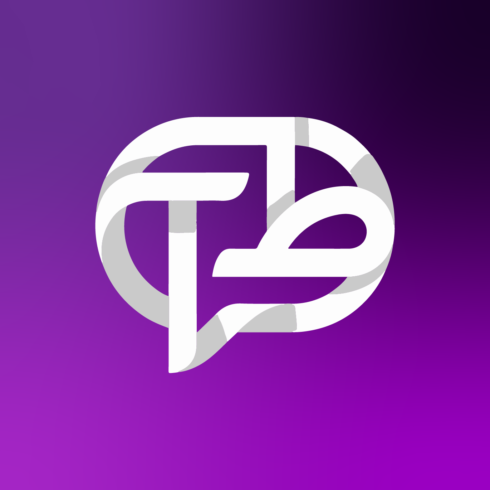

<div align="center">



# Talagh | طلاقة

### Five words a day. Confidence that stays.

**A personal, offline-first vocabulary trainer for advanced everyday, professional, and engineering English.**

[Features](#-features) · [How it works](#-how-it-works) · [Getting started](#-getting-started) · [AI acknowledgements](#-ai-acknowledgements)

</div>

---

## 🌱 About the project

**Talagh (طلاقة)** is a personal learning project built around a simple idea: vocabulary becomes useful when you can **recall it, understand it in context, and use it confidently**—not just recognize its translation.

The app encourages a manageable daily habit of **five focus words**, followed by varied practice and review. Its vocabulary emphasizes **upper-intermediate to advanced English (approximately B2+–C1)**, balancing language used in everyday life and the workplace with technical terms relevant to **mechanical maintenance, rotating equipment, hydraulics, and engineering**.

Talagh began as a tool for personal growth and hands-on web development. It is designed to stay focused, approachable, and useful over time.

## ✨ Features

- **Five-word daily plan:** Learn up to five focus words per day, with priority given to words that need reinforcement.
- **Mistake-aware learning:** Words missed at least twice in independent attempts are flagged for additional practice on the following day.
- **Varied exercises:** Multiple choice, typing, fill-in-the-blank, and listening activities.
- **Spaced repetition:** Previously learned words return for review on an expanding schedule.
- **Advanced word bank:** A mix of general, professional, and engineering vocabulary, with the option to add your own words.
- **Learning insights:** Track progress, accuracy, and words that need extra attention.
- **Local-first privacy:** Learning data is stored in your browser using IndexedDB.
- **Backup & restore:** Export and import your learning data to keep a personal backup.
- **Responsive interface:** Designed for desktop and mobile, with light and dark themes.
- **PWA support:** Installable on supported devices; previously cached app resources can work offline.

> **Note:** CEFR levels assigned to individual words are approximate learning labels, not an official language assessment.

## 🔄 How it works

```text
Review earlier words
        ↓
Identify words needing reinforcement
        ↓
Fill the five daily slots
(reinforcement first, then new words)
        ↓
Learn each word in context
        ↓
Practice with different question types
        ↓
Save progress and schedule future reviews
```

If two of yesterday's words need more practice, for example, today's plan contains **two reinforcement words and three new words**. Due reviews from older lessons may appear separately, so the five-word plan stays manageable without forgetting earlier vocabulary.

## 🧰 Tech stack

| Technology | Purpose |
| --- | --- |
| HTML, CSS, JavaScript | Frontend application |
| IndexedDB | Local learning data and progress |
| LocalStorage | Lightweight UI preferences |
| Service Worker + Web App Manifest | PWA and offline support |
| [Flaticon UIcons](https://www.flaticon.com/uicons) | Interface icons |
| GitHub Pages | Static-site hosting option |

**No backend or account is required** for the local learning experience.

## 🚀 Getting started

1. Clone or download this repository.
2. Open the project folder in your editor.
3. Serve the project locally (for example, with **VS Code Live Server** or `python -m http.server 5500`).
4. Open the local address shown by your server and begin your daily lesson.

For deployment, publish the static project files through **GitHub Pages**. PWA functionality generally requires **HTTPS or localhost**.

> **Your data stays in your browser.** Clearing browser site data, changing browsers, or using another device can remove or separate your progress. Export a backup regularly; there is no automatic cross-device sync.

## 🎨 Design & identity

The name **Talagh (طلاقة)** reflects the project's goal: building greater fluency, one meaningful word at a time.

The visual direction combines a clean, modern interface with an Arabic-inspired logo and a distinct purple identity. The brand and logo were developed through **the creator's own design decisions and collaboration with Google Gemini**.

The interface uses **Flaticon UIcons**; icon rights and applicable attribution requirements belong to their respective owners.

## 🤖 AI acknowledgements

Talagh is a **personal project directed and curated by its creator**, developed with the assistance of AI tools:

- **OpenAI ChatGPT:** Assisted with product planning, learning-system logic, frontend implementation, debugging, and documentation.
- **Google Gemini:** Collaborated on the visual identity and logo design process.

AI was used as a **creative and development assistant**, not as a replacement for the creator's concept, decisions, testing, or ongoing improvements.

## 🛣️ Roadmap

- [ ] Improve contextual exercises and accepted synonyms.
- [ ] Expand and refine the B2+–C1 vocabulary library.
- [ ] Strengthen progress insights and review scheduling.
- [ ] Improve accessibility and small-screen usability.
- [ ] Add optional features based on real learning needs.

## 📄 Project status & usage

Talagh is an evolving personal project. Features and learning rules may change as it is tested and improved.

**License:** No license has been specified yet. Please do not assume that the source code or brand assets are licensed for reuse; add a `LICENSE` file if you decide to publish under an open-source license.

---

<div align="center">

**Talagh · طلاقة**  
*Learn beyond memorization.*

</div>
